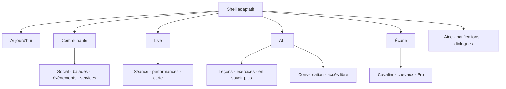

# Architecture de navigation NewRide V2

Implémentation web React 19 / TypeScript / React Router 7, distincte de la production originale. Direction visuelle validée par Aurélie le 17 novembre 2026 : photographie équestre plein cadre, vert profond, crème, typographie sportive et accent corail. Références : https://dribbble.com/tags/mobile-app-design et https://dribbble.com/search/coaching-app ; aucune maquette ou image Dribbble reproduite.

| Espace | Racine | Sous-parcours |
|---|---|---|
| Aujourd’hui | `/` | Accueil photographique, raccourcis, carnet réel local |
| Communauté | `/discover` | `rubrique=social/routes/events/services/top` |
| Live | `/live` | `/performances`, `/carte`, `/seance-guidee`, `/seances/:id` |
| ALI | `/coaching` | `/lecons`, `/ali`, `/ali/conversation`, `/ali/a-propos`, `/exercices`, `/coaching/:id`, `/sources` |
| Écurie | `/ecurie` | profil cavalier, chevaux locaux, `/pro`, `/experts` |

## Organisation et code

- `src/app/navigation.ts` : identifiants typés, appartenance des routes, parents de liens profonds et contrôle de destination après connexion.
- `src/app/NavigationState.tsx` : dernière route par espace, positions de défilement et reconstruction du parent au chargement direct.
- `src/app/routes.tsx` : configuration déclarative complète. React Activity garde les vues des espaces visités en mémoire ; bibliothèques chargées à la demande.
- `src/app/LegacySession.tsx` : indicateur vocal global issu du moteur, sans garde de navigation.
- `src/app/App.tsx` : navigation à cinq destinations, barre mobile, rail desktop rétractable, dialogues et moteur persistant.
- `src/features/` : Dashboard, AliHub/Lessons/AboutAli, Newridebis, Coaching, Live, Stable, Experts.
- `src/components/ui.tsx` : boutons, cartes, badges, skeletons et dialogues réutilisés.
- `src/design/` : thème existant, styles communs et direction éditoriale `editorial.css`.
- `public/newridebis/` : moteur historique invisible et pont de service. Les anciennes pages ne sont plus affichées.
- `public/photos/` : photographies optimisées et servies localement ; provenance dans `docs/PHOTOGRAPHIES.json`.

## Comportement

Changer d’espace revient à son dernier sous-parcours et conserve ses saisies en mémoire. Retoucher l’espace actif ramène à sa racine. Un moteur historique unique reste monté pour éviter de couper une conversation lorsqu’on consulte un autre espace ; un indicateur global signale une voix active. Les messages du pont vérifient l’origine et la fenêtre émettrice. Les commandes de navigation ne déclenchent jamais le microphone.

L’exploration ne crée pas de compte et aucun garde de connexion ne bloque la navigation. `/connexion` redirige vers `/coaching`. Les services privés conservent leurs contrôles serveur ; leur indisponibilité en mode invité produit un message dans la page. Les identifiants et jetons ne traversent pas le pont. Les commandes du pont sont limitées à une liste explicite et vérifient l’origine et la fenêtre émettrice.

Les cinq piles sont des états de vues web conservés, pas cinq navigateurs natifs. Une actualisation reconstruit la route et son parent mais ne restaure pas les saisies transitoires. La recette clavier, mobile réel et conversation authentifiée doit être complétée avant une qualification production.

## Design et accessibilité

Accueil : grande photographie, accroche, accès séance et carte ALI ; puis entrées photographiques apprendre/explorer/partager. ALI : conversation mise en avant, catalogue et fonctions ; intention et limites dans « En savoir plus ». Live : commandes réelles du moteur repris. Écurie : partenaire, profil et carnet local.

Entrée par léger zoom photographique et apparition du texte, sans écran bloquant. `prefers-reduced-motion` supprime les animations. Police locale Inter / Barlow Condensed. Pictogrammes vectoriels monochromes cohérents, sans emojis décoratifs dans le coaching repris. Cibles principales de 48 px minimum ; navigation et contenus adaptés aux petits écrans.

## Vues fonctionnelles harmonisées

`src/features/workspace/` sépare AliPage, LivePage, PerformancePage, MapPage, CommunityPage et ProPage. `shared.tsx` fournit les composants communs et le suivi GPS global ; `model.ts` conserve l’état des formulaires. `src/features/Workspace.tsx` sélectionne la vue. L’accueil approuvé reste dans Dashboard sans modification.

## Preuves et limites

Dix tests unitaires : état de séance, chronométrage, sauvegarde, favoris, durées, destinations sûres et parents de navigation. Compilation TypeScript stricte et build Vite. Recette navigateur : accueil photographique, catalogue et recherche « contact » conservée après changement d’espace.

La présence du code vocal et de ses boutons n’est pas une validation d’une conversation réelle. Même réserve pour le social partagé, l’analyse vidéo, la réservation et le casque BLE. La V2 utilise les services Supabase/fonctions du produit existant pour les fonctions reprises : elle n’est pas un environnement de données isolé. Aucun schéma, politique RLS ou réglage Supabase de production modifié pour cette livraison.

